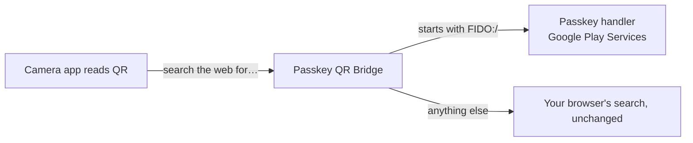

# Passkey QR Bridge


Sign in with a passkey by scanning the computer's QR code with your phone's **own camera app**.

When a computer offers "use a phone or another device" for a passkey sign-in, it shows a QR code
that starts with `FIDO:/`. Google's scanner and the Pixel and Samsung cameras pass that code to
Android's passkey handler. Many other camera apps (seen on RedMagic/Nubia; other makers' own
camera apps likely too) read the QR, don't recognise the code, and **send it to a web search**:
you get a browser page full of gibberish instead of a sign-in prompt.

This app sits in front of web search:



- No internet permission, no data kept, no background service. One 100-line class does the routing.
- Never on screen during use; it starts, hands the request on, and closes.
- Ordinary QR codes are untouched: the camera opens links and joins Wi-Fi itself and never sends a
  search. Only text it doesn't understand comes through here, and that goes on to your browser.

## Setup

1. Install, open **Passkey QR Bridge**, tap **Set up**.
2. Android asks which app should handle the search: choose **Passkey QR Bridge**, then **Always**.
3. If the screen says searches "always go to" another app, tap the button to open that app's
   settings → **Open by default** → **Clear defaults**, then repeat step 1.

Then scan a passkey QR with the camera. Bluetooth must be on (the passkey protocol uses it to prove
the phone is near the computer).

## Known: "Something went wrong" after a successful sign-in

With some computers the phone shows an error a moment after the sign-in has already gone through.
The phone's log shows why: the passkey answer is sent, then the computer sends one more message that
Google Play Services doesn't recognise (`Received invalid CTAP command`, `INVALID_CTAP`). The
sign-in is complete by then; the error is cosmetic and is not caused by this app (Google's own
scanner shows it too).

## Build

```sh
./gradlew assembleRelease     # app/build/outputs/apk/release/
```

Release signing reads `PQB_KEYSTORE`, `PQB_KEYSTORE_PASSWORD`, `PQB_KEY_ALIAS` (and optionally
`PQB_KEY_PASSWORD`) from the environment; without them the release APK is unsigned.

Android 9+ (passkeys over QR need it). No dependencies beyond the Android framework.

## License

MIT
